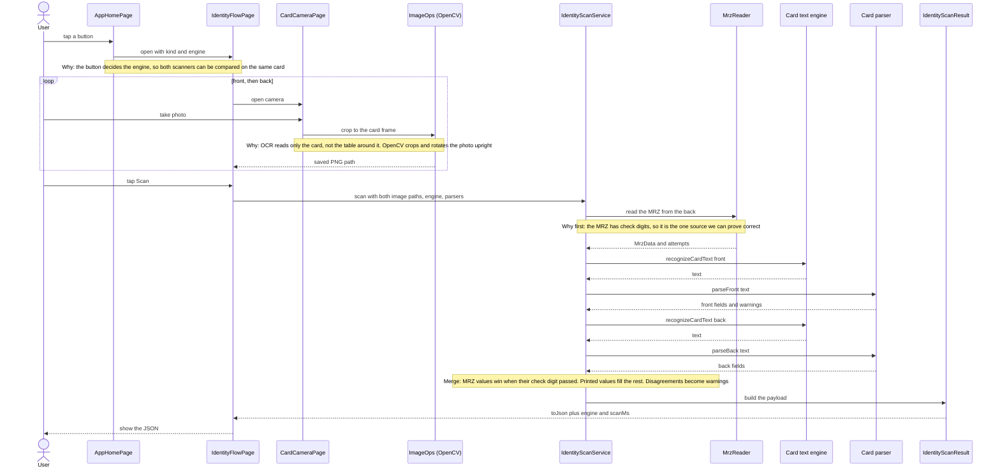
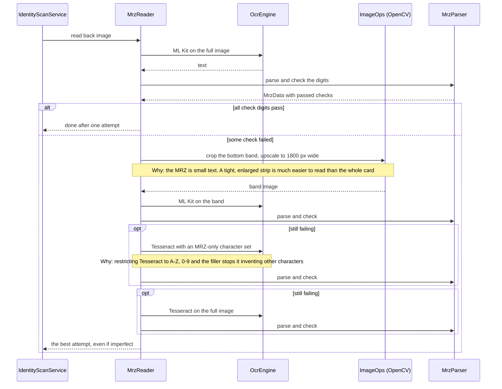
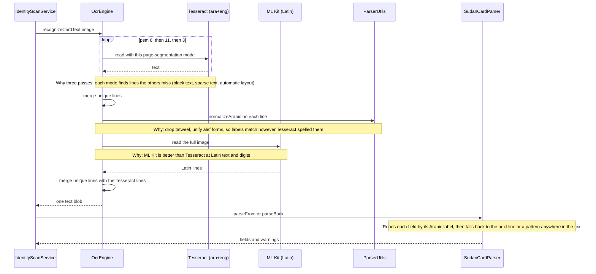
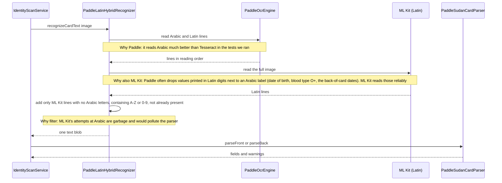
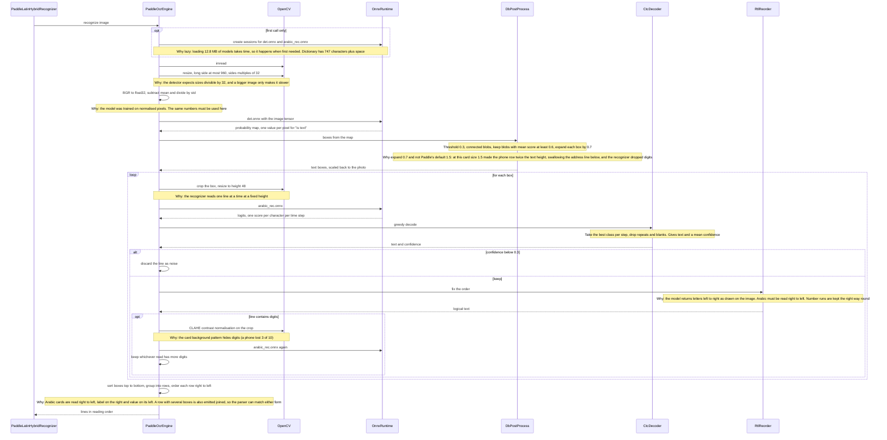
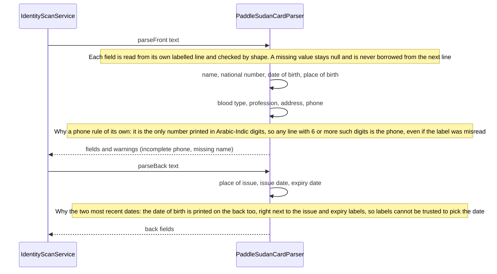
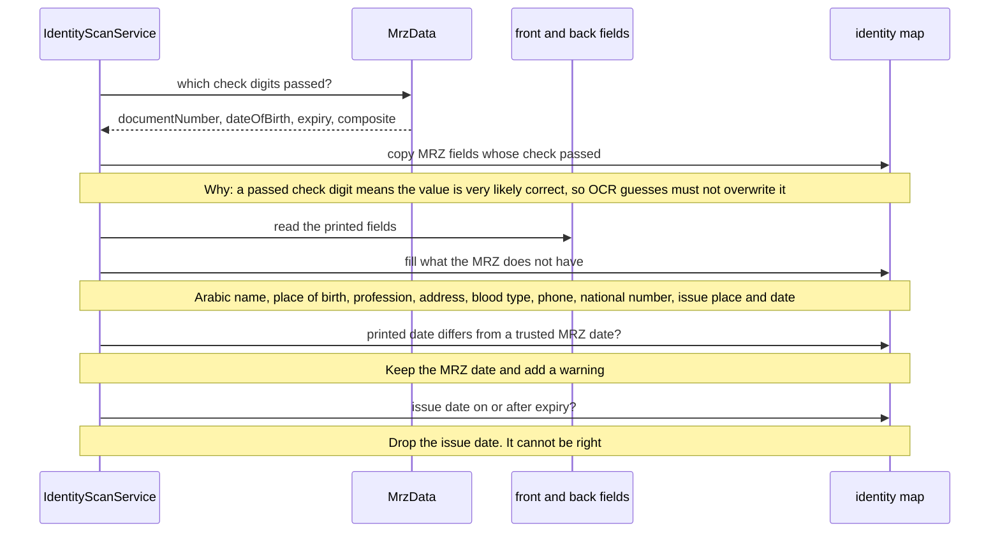

# OCR flows: Tesseract (classic) and Paddle

The app has two scanners for the printed text of a Sudan ID, side by side on the home page:

| Home button | Engine | `engine` in the payload |
|---|---|---|
| Sudan ID (front + back) | **Classic**: Tesseract `ara+eng` + ML Kit | `classic` |
| Sudan ID, Paddle OCR (beta) | **Paddle**: PaddleOCR on ONNX Runtime + ML Kit Latin | `paddle+mlkit-latin` |
| Passport | Classic (Paddle is not wired for passports) | `classic` |

Both share the capture screen, the MRZ stage, the merge step and the payload. They differ only
in how the **printed card text** is read and parsed.

Every diagram below is a sequence diagram: each box at the top is an object (a class or a
library), each arrow is a call or a result, and each note says **why** that step exists.

Status: both work. Paddle is a prototype tuned on one Sudan ID and one Android phone; neither
engine has been measured on a set of real cards.

---

## 1. Who is who (the objects)

| Object | What it is | Why it exists |
|---|---|---|
| `IdentityFlowPage` | the screen that runs a scan | collects the photos, picks the engine, shows the JSON |
| `CardCameraPage` | camera screen | takes the photo and crops it to the card frame |
| `ImageOps` | crop helper (uses **OpenCV**) | crops and upscales images before OCR |
| `IdentityScanService` | the orchestrator | runs MRZ, card text and merge in order |
| `MrzReader` / `MrzParser` | MRZ stage | find the 3 MRZ lines and verify their check digits |
| `OcrEngine` | classic OCR (**Tesseract** + **ML Kit**) | reads card text the classic way; also reads the MRZ for both engines |
| `PaddleLatinHybridRecognizer` | Paddle's front door | combines Paddle (Arabic) with ML Kit (Latin and digits) |
| `PaddleOcrEngine` | Paddle pipeline | finds text lines, reads each one |
| `OnnxRuntime` | `flutter_onnxruntime` | runs the two Paddle models on the phone |
| `DbPostProcess` | detector post-processing | turns the detector's output map into boxes |
| `CtcDecoder` | recognizer post-processing | turns the recognizer's output into characters |
| `RtlReorder` | Arabic order fix | recognizer output is left to right, Arabic must be right to left |
| `SudanCardParser` / `PaddleSudanCardParser` | text to fields | classic and Paddle parsers |

---

## 2. Why OpenCV?

OpenCV is a native image-processing library (C++) used through the `opencv_dart` package.
It is **not an OCR engine**. It only prepares pictures. Here is every use:

| Where | OpenCV calls | Why |
|---|---|---|
| `ImageOps.crop` (both engines) | `imread`, `rotate`, region crop, `resize` (cubic), `imwrite` | cut the photo to the card frame; rotate a landscape-saved photo upright; **upscale the thin MRZ strip** so Tesseract and ML Kit can read it |
| `PaddleOcrEngine` detection | `imread`, `resize` | the detector needs an image of a fixed kind: long side up to 960 px, sides multiples of 32 |
| `PaddleOcrEngine` recognition | region crop, `resize` to height 48 | the recognizer reads one text line at a time, scaled to a fixed height |
| `PaddleOcrEngine` digit retry | `cvtColor` (to LAB and back), `split`, `merge`, **CLAHE** | the card background pattern hides digits; contrast normalisation brought back a phone number that lost 3 of 10 digits |

**Why OpenCV and not Dart's own image code?**

- It is fast: these steps run on full camera photos (several megapixels). Pure Dart
  per-pixel loops would be much slower.
- Flutter's built-in image classes cannot crop or resample files without a UI, and no
  common Dart package has CLAHE.
- It was already in the project for `ImageOps` before Paddle was added; Paddle reuses it.

**What it costs:** about 10.5 MB per phone (arm64), even trimmed to two modules
(`imgcodecs`, `imgproc`) in `pubspec.yaml`. It is also what makes `flutter test` fail in
this environment (the native build needs CMake).

**Honest answer on whether you need it:** the crop and upscale could be done with a pure-Dart
image package, and the Paddle resize steps could be too, at lower speed. CLAHE is the one
thing that would have to be rewritten by hand. If app size matters more than scan speed,
dropping OpenCV is possible but is a separate piece of work.

---

## 3. The whole scan (shared by both engines)



The only things that change between engines are the two objects in the middle:
**Card text engine** and **Card parser**. Sections 5 and 6 open those up.

---

## 4. Stage 1: the MRZ (shared)



`MrzParser` reads the TD1 layout (3 lines of 30 characters), repairs letter and digit
confusions by field type (O/0, I/1, S/5, B/8) and verifies four check digits: document
number, date of birth, expiry and the composite. Every attempt is stored in `mrzAttempts`.
Both engines use this stage, including its Tesseract fallback.

---

## 5. Classic engine: Tesseract + ML Kit



Notes:

- No image pre-processing: the cropped photo goes straight in.
- Output is plain text; no boxes or confidences.
- Parser rules: name after الإسم (else a 3-word Arabic line); national number is 11 digits;
  date of birth after تاريخ الميلاد; place of birth, profession, address after their labels;
  blood type pattern `[ABO][+-]`; phone is a 10-digit number starting 09 or 01 on the `ت/`
  line; on the back, issue and expiry dates by label or the two most recent dates.
- **Weak points seen in the code** (found when this parser was fed Paddle text, so they
  apply to any text it receives): with a required pattern and no value on the label's line,
  the next line is returned unchecked, so a national number could come out as the next label;
  the blood-type pattern ends with `\b`, which cannot match after `+` at the end of a line;
  an address on the line below its label is missed; labels must match exactly. The classic
  parser is deliberately left unchanged as the baseline, so these are documented, not fixed.
- Cost: Tesseract models 5.5 MB + native libraries about 8.3 MB (arm64), about 14 MB.

---

## 6. Paddle engine

### 6.1 Overview: the hybrid recognizer



### 6.2 Inside `PaddleOcrEngine`



### 6.3 Why each Paddle design choice

| Choice | Why |
|---|---|
| Two models (detector + recognizer) | OCR here is two jobs: find the lines, then read each one. Paddle splits them |
| ONNX Runtime | runs the converted models on the phone, offline, on both Android and iOS, with no Paddle framework in the app |
| Converted from the official weights ourselves | no official ONNX files exist; our conversion is documented with SHA-256 in `assets/models/paddle/README.md` |
| CTC decoding | the recognizer outputs a score per time step, not a string; CTC turns it into characters |
| Right-to-left reorder | without it Arabic text comes out reversed, and Arabic-Indic digits (٠-٩) must not be reversed with the letters |
| CLAHE retry only on digit lines | it fixes digits but would slow every line; one extra read where it matters |
| Hybrid with ML Kit | Paddle misses Latin-digit values, ML Kit does not |
| Own parser | the classic parser's fall-backs return wrong values when Paddle gives clean separate lines |

### 6.4 `PaddleSudanCardParser`



| Field | Rule |
|---|---|
| `arabicName` | after the name label (tolerates الإسم / الاسم / ااسم); if the label is lost, the first Arabic line of 3+ words above the date of birth that is not a heading |
| `nationalNumber` | exactly 11 digits; labelled line first, then any line |
| `dateOfBirth` | `yyyy/mm/dd` or `dd/mm/yyyy`; labelled line first, then any line |
| `placeOfBirth`, `profession` | Arabic text after their label |
| `bloodType` | A, B, AB or O with `+` or `-`; sign on either side; `0` read as `O`; label line first, then short lines with no Arabic |
| `address` | text after the address label minus the phone part, else the first real Arabic line below it (6+ letters), skipping the issuing-authority block that can sit between them |
| `phone` | digits after `ت/`, converted to Latin; a lost leading 0 is added; a trailing 1 that was really the `/` is dropped; other than 10 digits triggers a warning |
| back `placeOfIssue` | after `مكان الإصدار`; the label accepts a misread last letter (الإصدان) because the `:` is often read as a letter |

---

## 7. Stage 3: merge and cross-check (shared)



---

## 8. Side by side

| | Classic | Paddle |
|---|---|---|
| Arabic OCR | Tesseract `ara+eng`, 3 passes | PaddleOCR detector + Arabic recognizer |
| Latin text and digits | ML Kit (merged) | ML Kit (lines without Arabic merged) |
| Image pre-processing | none | resize for the detector; CLAHE retry on digit lines |
| Line detection | Tesseract's own | DB detector, 0.7 box expansion |
| Right-to-left handling | inside Tesseract | explicit reorder of the recognizer's output |
| OCR output | text only | text with boxes and confidences |
| Parser | `SudanCardParser` | `PaddleSudanCardParser` |
| Missing value | can borrow the next line | stays `null` |
| Phone | exactly 10 digits starting 09 or 01 | digits after `ت/`, repaired, flagged if not 10 |
| Raw OCR text in payload | no (Sudan ID) | yes (`rawText`) |
| Size (arm64) | about 14 MB | about 41 MB (ONNX Runtime 28.6 + models 12.8) |
| OS requirement | none extra | iOS 16.0+, static linking |
| Speed | not measured | about 7 s per scan on one phone |
| Known weaknesses | see section 5 | Arabic letter confusions; heuristic row grouping; axis-aligned boxes only; needs ML Kit for Latin values |

OpenCV (about 10.5 MB) and ML Kit (about 11 MB) are in the app for both engines.

---

## 9. Payload

`IdentityScanResult.toJson()` plus `engine` and `scanMs` (both engines) and `rawText`
(Paddle only). All values below are **made up**, to show the shape.

```json
{
  "documentKind": "sudanId",
  "identity": {
    "documentType": "ID",
    "documentNumber": "012345678",
    "nationalNumber": "12345678901",
    "arabicName": "اسم أول اسم ثاني اسم ثالث",
    "englishName": "FIRST SECOND THIRD FAMILY",
    "surname": "FAMILY",
    "givenNames": "FIRST SECOND THIRD",
    "dateOfBirth": "1990-01-15",
    "sex": "M",
    "nationality": "SDN",
    "issuingCountry": "SDN",
    "issueDate": "2022-05-17",
    "expiryDate": "2027-05-16",
    "placeOfBirth": "الخرطوم - أم درمان",
    "placeOfIssue": "مجمع بحري",
    "profession": "طالب",
    "address": "حي المثال بحري الخرطوم",
    "bloodType": "O+",
    "phone": "0912345678"
  },
  "mrz": {
    "format": "TD1",
    "documentCode": "ID",
    "issuingCountry": "SDN",
    "documentNumber": "012345678",
    "dateOfBirth": "1990-01-15",
    "sex": "M",
    "expiryDate": "2027-05-16",
    "nationality": "SDN",
    "surname": "FAMILY",
    "givenNames": "FIRST SECOND THIRD",
    "optionalData": "",
    "checks": { "documentNumber": true, "dateOfBirth": true, "expiryDate": true, "composite": true },
    "isValid": true,
    "lines": ["IDSDN…", "…", "…"]
  },
  "front": { "arabicName": "…", "nationalNumber": "…", "dateOfBirth": "1990/01/15",
             "placeOfBirth": "…", "bloodType": "O+", "profession": "…",
             "address": "…", "phone": "0912345678" },
  "back":  { "placeOfIssue": "…", "issueDate": "2022/05/17", "expiryDate": "2027/05/16" },
  "warnings": [],
  "images": { "front": "/data/user/0/<app>/cache/card_front_….png",
              "back":  "/data/user/0/<app>/cache/card_back_….png" },
  "rawText": { "front": "<what OCR read, one line per box>", "back": "<…>" },
  "mrzAttempts": [ { "source": "mlkit/full", "text": "…", "passedChecks": 4 } ],
  "scannedAt": "2026-10-29T10:00:00.000",
  "engine": "paddle+mlkit-latin",
  "scanMs": 7140
}
```

How to read it:

- **`identity`** is what consumers should use: merged and cross-checked.
- **`front` / `back`** are the parser outputs (`null` where nothing was read), to see what came
  from the printed card versus the MRZ.
- **`rawText`** (Paddle) is exactly what OCR returned before parsing. When a field is wrong,
  look here first: if the text is not there, the problem is recognition; if it is, the parser.
- **`warnings`**: missing required fields, MRZ and print disagreements, incomplete phones.
- **`mrz.checks` and `isValid`**: whether the MRZ values can be trusted.
- **`mrzAttempts`**: every MRZ read, for debugging.
- **`engine` and `scanMs`**: make the two engines comparable on the same card.

---

## 10. Files

```
lib/features/identity_scan/
  data/
    identity_scan_service.dart             orchestrates the three stages
    image/image_ops.dart                   crop and upscale (OpenCV)
    mrz/mrz_reader.dart, mrz_parser.dart   MRZ stage (shared)
    front/sudan_card_parser.dart           classic parser
    front/parser_utils.dart, card_dates.dart   helpers used by the classic parser
    ocr/
      card_text_recognizer.dart            interface both engines implement
      ocr_engine.dart                      classic engine (Tesseract + ML Kit)
      paddle/
        paddle_ocr_engine.dart             detector + recognizer pipeline
        db_postprocess.dart                probability map to boxes
        ctc_decoder.dart                   logits to text
        rtl_reorder.dart                   visual to logical order
        paddle_latin_hybrid_recognizer.dart  Paddle + ML Kit Latin lines
        paddle_sudan_card_parser.dart      Paddle parser
  domain/scan_engine.dart                  classic | paddle
  presentation/pages/identity_flow_page.dart   chooses the engine per scan
assets/tessdata/                           Tesseract ara + eng
assets/models/paddle/                      ONNX models, dictionary, provenance README
```

The classic scanner is intentionally untouched; Paddle fixes live only in `paddle/`.
The engine is picked through optional parameters on `IdentityScanService.scan`
(`cardText`, `parseFront`, `parseBack`, `includeRawText`); with none given it runs the classic
path exactly as before.

Models (`assets/models/paddle/`):

| File | Source | Size |
|---|---|---|
| `det.onnx` | `PaddlePaddle/PP-OCRv5_mobile_det`, paddle2onnx 2.1.0, opset 14 | 4.8 MB |
| `arabic_rec.onnx` | `PaddlePaddle/arabic_PP-OCRv5_mobile_rec`, same conversion | 8.0 MB |
| `arabic_dict.txt` | `character_dict` from the recognizer's `inference.yml` | 2 KB |

---

## 11. Known limits and next steps

- **Single-card tuning.** Paddle's constants (box expansion 0.7, confidence 0.3, CLAHE 2.0 with
  4x4 tiles) and parser rules were tuned on one Sudan ID and one phone. Run both engines on
  30 to 50 real cards (good and bad light) and compare field accuracy before choosing.
- **Arabic misreads remain** in Paddle (ميرغنى for ميرغني, الحرطوم for الخرطوم); no word
  lists or spell correction are applied.
- **Axis-aligned boxes only** in Paddle: a tilted card reads worse.
- **Latin values depend on ML Kit** in the Paddle path.
- **Speed.** About 7 s for Paddle; tensors cross a platform channel and pixel loops run in
  Dart. A smaller detector input or an FFI runtime are untried.
- **Tests.** `flutter test` does not run in this environment (the OpenCV native build
  fails); decoder, detector and parser checks ran as standalone Dart scripts.
  `test/paddle_decoding_test.dart` covers the decoder and right-to-left code.
- **Moving to a package.** Add `flutter_onnxruntime`, set iOS to 16.0 with static linking,
  bundle `assets/models/paddle/`; asset paths become `packages/<name>/assets/...` (three
  constants at the top of `PaddleOcrEngine`). Paddle adds about 41 MB per phone (arm64,
  uncompressed); replacing Tesseract nets about +27 MB.
